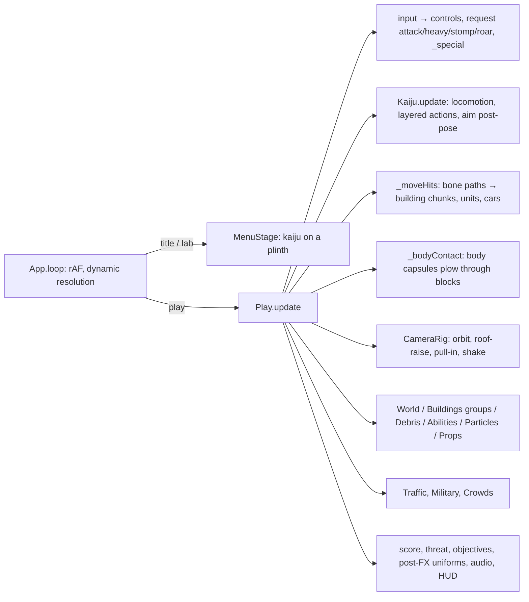

# LANDFALL: Architecture

LANDFALL is a browser game built on three.js r186, vendored in `vendor/`, using ES modules with no framework. The creatures and props come from an offline Blender pipeline, `blender/`, which writes GLB and JSON files to `assets/`. Everything else is generated at load time: the city, the sky, the facades and the audio.

## Frame flow

## Key mechanisms

**Kaiju assets** (`blender/build.py <name>` with a spec module `k_<name>.py`)
1. `sculpt()` returns signed-distance primitives (round cones and ellipsoids with smooth union and subtraction, each owned by a bone).
2. `noise()` adds surface detail. The field is evaluated on a grid and meshed with marching cubes.
3. Blender decimates the mesh to `LOW_TRIS`.
4. A procedural high-detail material (`LOOK`) is baked to albedo, normal, ORM and emissive maps.
5. Skin weights come from the nearest primitive's bone. They are then smoothed over mesh adjacency, except across `HARD` bone pairs.
6. Rigid parts such as horns, teeth and spikes come from `parts()` and are bound to one bone each.
7. Animations are Python functions `fn(t, T, pose)` built from FK rotations and two-bone IK (`rig.py`, `anim_lib.py`). They are keyframed and exported as NLA tracks.
8. `META` is written next to the GLB:
   - walk and run speeds
   - foot bones and foot phases for footstep events
   - body capsules for collision
   - the aim chain and mouth bone
   - the model height

**Moves** (`src/core/Config.js`)
- Each kaiju lists `moves`. A melee move names a bone or bones, a radius, an optional `reach`, and a `window` in seconds of clip time.
- `Play._moveHits` sweeps spheres along the bone paths between frames, so fast swings do not tunnel.
- Stomps fire at `time`. The `aoe` heavies slam once.
- Signature powers are dispatched by `kind`:
  - `beam` and `spray` use the clips `special_in`, `special_loop` and `special_out`.
  - `throw` uses grab, hold and throw.
  - `charge` uses the run cycle at boosted speed.
  - The `leap` stomp plays its clip at a rate matched to the ballistic flight.

**Animation layering** (`Kaiju.js`)
- Idle, walk and run share one normalised phase, blended by speed.
- An action plays full-body when standing. While moving it plays as `_upper`, so the locomotion keeps the leg bones.
- `LEG_BONES` holds the leg bones. Crab legs (`legN`, `legNlo`, `footN`) count as legs, and so do the forelimbs of kaiju marked `quadruped`.

**City** (`src/world/`)
- `CityGen` lays out roads, blocks and buildings for each preset.
- `Buildings` splits every building into a grid of chunks, one floor band per layer. The chunks are drawn as instanced boxes in spatial tiles, with a facade shader (`BuildingShader.js`) that works in building-local coordinates.
- Damage lowers chunk HP. A broken chunk becomes fractured `Debris`.
- `checkSupport` finds storey failures and chunks with no path to the ground. Everything above becomes a rigid falling group that pancakes or topples.

**Lighting** (`src/render/`)
- `Sky` bakes a physical single-scattering sky to a cube map. That cube drives the PMREM image-based lighting and the fog colour.
- `Shading.patch()` is applied to every material. It adds:
  - cascaded shadow maps
  - height-based aerial fog
  - a `kjSafe` clamp against NaN and Inf values in the half-float target
  - the building cutaway around the kaiju
- `G.uExposure` mirrors the current exposure, so emitters such as kaiju veins can hold a steady on-screen brightness.

**Assets at runtime**
- `Assets.js` fetches from `assets/`.
- The single-file build (`tools/build.mjs`) embeds every asset as base64 in `window.__KJ_ASSETS__`, and the loader uses those first.

## Adding a kaiju
1. Write `blender/k_<name>.py` with:
   - `NAME`, `VOXEL`, `LOW_TRIS`
   - `skeleton()`, `sculpt()`, `noise()`, `body_color()`, `parts()`
   - `HARD`, `LOOK`, `PART_MATS`
   - `ANIMS` with the 13 standard clip names, or 10 with no special clips
   - `META`
2. Iterate with `shape_preview.py`. Then use `build.py --fast --sheet ...` to check contact sheets.
3. Run the full build: `build.py <name>`.
4. Add the entry to `KAIJU` in `Config.js`. Name the move bones the way three.js sees them: dots are stripped, so `hand.R` becomes `handR`. Write windows in clip seconds.
5. Run `tests/play.mjs ... moves` and `tests/ui.mjs`, then rebuild `Landfall.html`.
