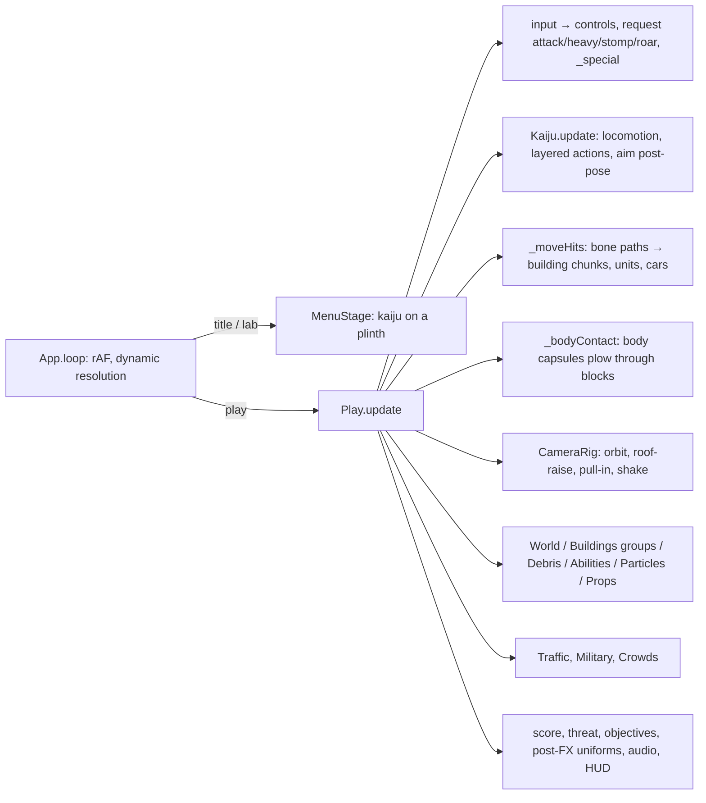

# LANDFALL: Architecture

LANDFALL is a browser game built on three.js r186, vendored in `vendor/`, using ES modules with no framework. The creatures and props come from an offline Blender pipeline, `blender/`, which writes GLB and JSON files to `assets/`. Everything else is generated at load time: the city, the sky, the facades and the audio.

## Frame flow

## Key mechanisms

**Kaiju assets** (`blender/build.py <name>` with a spec module `k_<name>.py`)
1. `sculpt()` returns signed-distance primitives, each owned by a bone and combined with smooth union and subtraction:
   - round cones and ellipsoids
   - `ellx` oriented ellipsoids
   - `blade` sheets, used for crests, knife skulls and fins
   - `tri` membranes, used for wing webs
2. `noise()` adds surface detail. The field is evaluated on a grid and meshed with marching cubes.
3. Blender decimates the mesh to `LOW_TRIS`.
4. A procedural high-detail material (`LOOK`) is baked to albedo, normal, ORM and emissive maps.
5. Skin weights come from the nearest primitive's bone. They are then smoothed over mesh adjacency, except across `HARD` bone pairs.
6. Rigid parts such as horns, teeth and spikes come from `parts()` and are bound to one bone each.
7. `body_color()` returns albedo, masks and an optional glow colour per vertex. The glow is baked to the emissive map; that is where the bioluminescent stripes, photophores and acid sacs come from. `LOOK` sets the skin relief, from scaly crags (`crag`) to patchy fleshy folds (`folds`).
8. Animations are Python functions `fn(t, T, pose)` built from FK rotations, two-bone IK and aims (`rig.py`). They are keyframed and exported as NLA tracks. Rigs carry fingers, mandibles, crests, tongues, antennae and wing spars as well as the core skeleton.
9. `META` is written next to the GLB:
   - walk and run speeds
   - foot bones and foot phases for footstep events
   - body capsules for collision
   - the aim chain and mouth bone
   - the model height
   - `springs`: chains that get in-game secondary motion. Tails do by default; this adds tongues, antennae and the like.
   - `launcher`: the bone mortar shots leave from

**Moves** (`src/core/Config.js`)
- Each kaiju lists `moves`. A melee move names a bone or bones, a radius, an optional `reach`, and a `window` in seconds of clip time.
- `Play._moveHits` sweeps spheres along the bone paths between frames, so fast swings do not tunnel.
- Stomps fire at `time`. The `aoe` heavies slam once.
- Signature powers are dispatched by `kind`:
  - `beam` and `spray` use the clips `special_in`, `special_loop` and `special_out`.
  - `spit` (fast flat globs) and `mortar` (high-arcing bombs from `meta.launcher`) use the same three clips. They fire one shot per heave of the loop clip and pay `cost` per shot.
  - `pulse` charges in `special_in`, then fires the EMP blast `hits.special_out` seconds into `special_out`.
  - `throw` uses grab, hold and throw.
  - `charge` plays `special_in` standing, then loops `special_loop` (a head-down run cycle) at 1.45× while the kaiju sprints, and ends with `special_out`.
  - The `leap` stomp plays its clip at a rate matched to the ballistic flight. `stomp.range` stretches the leap for winged kaiju.

**Animation layering** (`Kaiju.js`)
- Idle, walk and run share one normalised phase, blended by speed.
- An action plays full-body when standing. While moving it plays as `_upper`, so the locomotion keeps the leg bones.
- `LEG_BONES` holds the leg bones. Crab legs (`legN`, `legNlo`, `footN`) count as legs, and so do the forelimbs of kaiju marked `quadruped`.

**Mutation** (`src/kaiju/Mutation.js`, data in `Config.js`: `FORMS`, `GENES`, `SURGE`)
- `MutationRig` belongs to one model instance; `Kaiju` and `MenuStage` each make one.
- It adds a shader hook to every material through `patchTree(root, key, hookFor)`. The hook adds:
  - a varying with the bind-pose position, so patterns ride the skin
  - a hide recolour that mixes two tints in noise patches and keeps the baked detail as luminance
  - a seam network along 3D Voronoi cell walls. A light domain warp gives cracks; a heavy one gives branching veins. A patch noise breaks the network into runs.
  - the baked glow recoloured to the strain's colour
  - a fresnel rim
  - roughness and metalness shifts
- How strongly a material takes the strain depends on its name: hide fully, horn and keratin partly, eyes not at all.
- `setForm()` only changes uniform values, so switching strains never recompiles a shader.
- Growths are generated geometry: crystals, ice, bone spikes, sacs and shards. Sites are sampled from the body mesh, weighted by facing and by distance from the spine, and spaced apart. Bones that open, grip or flap are skipped.
  - Every growth vertex copies its root vertex's skin indices and weights.
  - The growth `SkinnedMesh` binds to the body's own skeleton, so growths ride every animation.
  - Geometry is cached per asset and strain.
- `emitAura()` sheds particles from random points on the `meta.body` capsules.
- `kaijuStats(id, levels, mut)` applies strain and gene `mul`/`add` modifiers. Scale changes come first, so health and damage follow the extra mass.
- Behaviours live in `Play`:
  - `_element` runs on a melee hit's first connect and on every `slam`.
  - `_dots` holds delayed and lingering effects: acid, rifts, aftershocks, echo roars.
  - `onHurt` handles Volatile Blood.
  - Seismic, Barbed Hide, Hyper-Regeneration and Feeding Frenzy hook into the footstep, body-contact, building-down and kill paths.
- Mutation Surge:
  - `Play._surge` fills the meter from the damage and kill deltas each frame.
  - `Kaiju.applySurge(a)` rebuilds the stats from `baseStats` and calls `setScale()`, so everything that reads `k.scale` follows.
  - The rig's `uMutSurge` uniform drives the seams and the rim.
- `Military.freeze` stops units dead and doubles the damage they take. Frozen gunships sink and crash.

**City** (`src/world/`)
- `CityGen` lays out roads, blocks and buildings for each preset.
- `Buildings` splits every building into a grid of chunks, one floor band per layer. The chunks are drawn as instanced boxes in spatial tiles, with a facade shader (`BuildingShader.js`) that works in building-local coordinates.
- Damage lowers chunk HP. A broken chunk becomes fractured `Debris`.
- `checkSupport` finds storey failures and chunks with no path to the ground. Everything above becomes a rigid falling group that pancakes or topples.

**Lighting** (`src/render/`)
- `Sky` bakes a physical single-scattering sky to a cube map. That cube drives the PMREM image-based lighting and the fog colour.
- `Shading.patch()` is applied to every material. It adds:
  - cascaded shadow maps
  - height-based aerial fog
  - a `kjSafe` clamp against NaN and Inf values in the half-float target
  - the building cutaway around the kaiju
- `G.uExposure` mirrors the current exposure, so emitters such as kaiju veins can hold a steady on-screen brightness.

**Assets at runtime**
- `Assets.js` fetches from `assets/`.
- The single-file build (`tools/build.mjs`) embeds every asset as base64 in `window.__KJ_ASSETS__`, and the loader uses those first.

## Adding a kaiju
1. Write `blender/k_<name>.py` with:
   - `NAME`, `VOXEL`, `LOW_TRIS`
   - `skeleton()`, `sculpt()`, `noise()`, `body_color()`, `parts()`
   - `HARD`, `LOOK`, `PART_MATS`
   - `ANIMS` with the 13 standard clip names, or 10 with no special clips
   - `META`
2. Iterate with `shape_preview.py`. Then use `build.py --fast --sheet ...` to check contact sheets.
3. Run the full build: `build.py <name>`.
4. Add the entry to `KAIJU` in `Config.js`. Name the move bones the way three.js sees them: dots are stripped, so `hand.R` becomes `handR`. Write windows in clip seconds.
5. Run `tests/play.mjs ... moves` and `tests/ui.mjs`, then rebuild `Landfall.html`.
